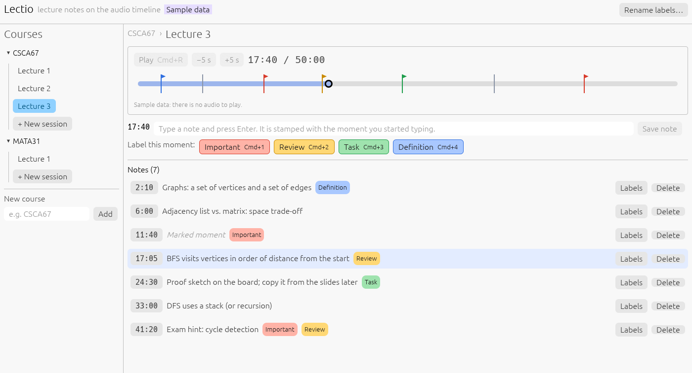

# Lectio

Open-source lecture note-taking. Record a class, take notes that are timestamped to the audio, and jump back to any moment by clicking a note. Local-first: your recordings and notes stay on your device, with no account.

One Rust codebase runs as a native app on **Windows, macOS and Linux** and as a **web app** (WebAssembly).



## Features
- [x] Courses and sessions
- [x] Recording with start / pause / resume / stop
- [x] Notes timestamped to the recording; one-tap labels (Important, Review, Task, Definition), renameable
- [x] Playback timeline with note markers; click a note to seek to it
- [x] Local-first storage (files on desktop, IndexedDB in the browser)
- [ ] PDF slides next to the notes, photo and sketch notes, reading view
- [ ] Transcription (local Whisper), search, audio clean-up, playback speed
- [ ] Task list, study tools (summaries, quizzes, flashcards), Markdown/PDF export

## Build and run
Requires a recent stable Rust toolchain.

```bash
# Desktop
cargo run --release

# Web (needs trunk: cargo install trunk --locked)
rustup target add wasm32-unknown-unknown
trunk serve --release        # then open http://127.0.0.1:8080

# Tests
cargo test --workspace

# Check the microphone pipeline on your machine (records N seconds, reports dropped frames / overruns)
cargo run --release -- --self-test-audio 30
```

On Linux you'll need the ALSA and X11/Wayland development packages; see `.github/workflows/ci.yml` for the exact list.

## How it's built
- `crates/lectio-core`: the data model, the recording clock, seek logic, resampling and storage. No UI, no audio, no platform code, so it's fully unit-tested and compiles unchanged for the browser.
- `src/platform/{native,web}`: recording, playback, storage and file access behind traits. Native uses `cpal` with a lock-free ring buffer for real-time-safe capture; the web uses an AudioWorklet and IndexedDB.
- `src/ui`: the egui interface.

The design is written up in the open:

| Doc | What's in it |
|---|---|
| [docs/ARCHITECTURE.md](docs/ARCHITECTURE.md) | Structure, data model, threads and flows |
| [docs/DECISIONS.md](docs/DECISIONS.md) | Architecture decision records: what I chose, the alternatives, and why |
| [docs/PROBLEMS.md](docs/PROBLEMS.md) | Bugs and dead ends, with the root cause and the fix |

## Known limitations
- The web version draws to a canvas, so screen readers can't read it yet (see PROBLEMS). The desktop app supports screen readers.
- Linux and Windows are verified in CI. Day-to-day testing is on macOS.

## License
MIT
