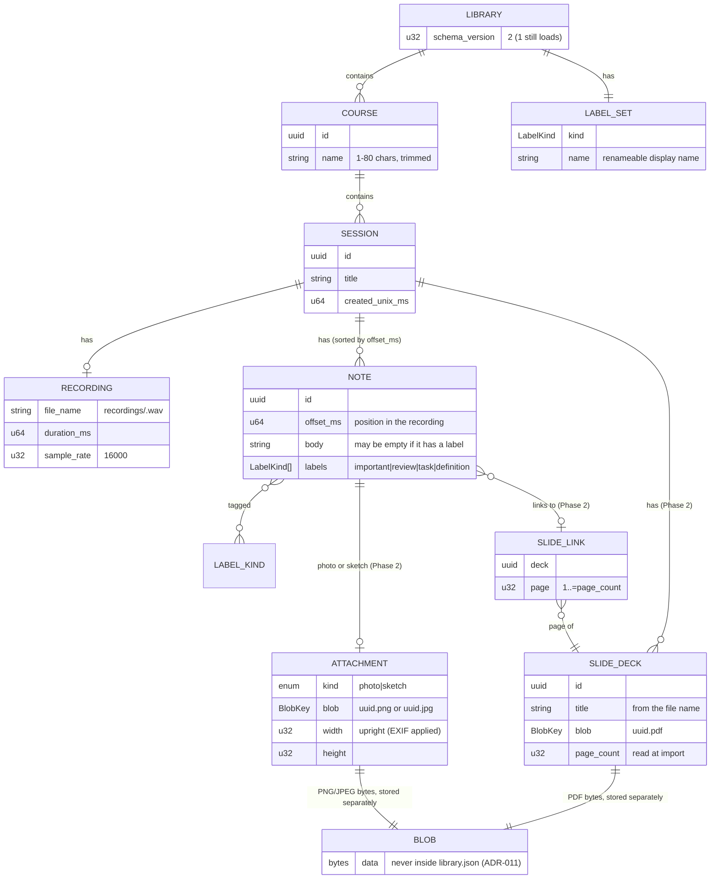
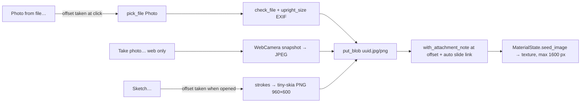
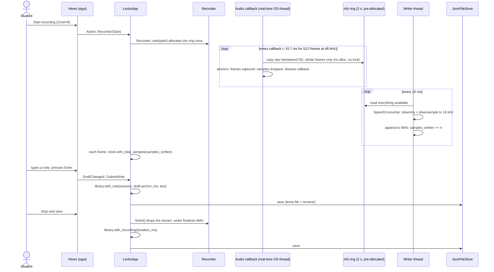
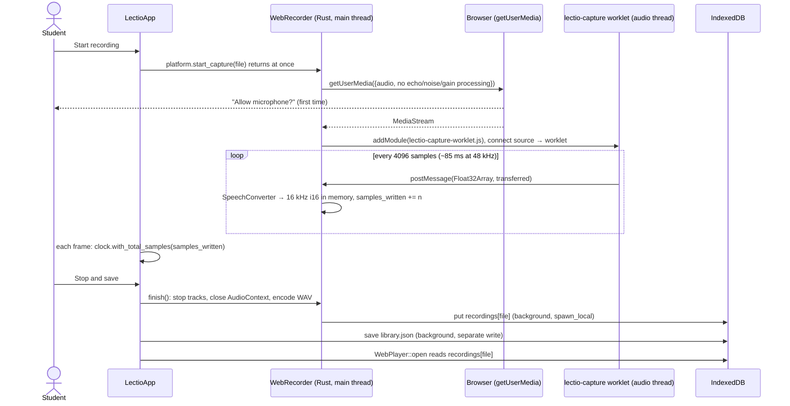
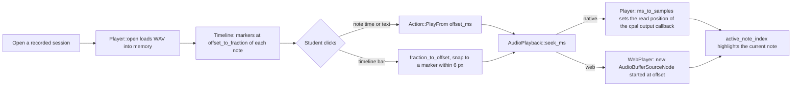
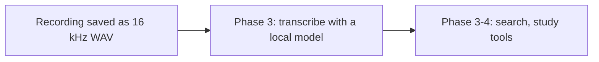

# Architecture


## Stack
Rust 2024 edition, **one codebase for Windows, macOS, Linux and the web** (ADR-009). UI with **eframe/egui 0.37** (ADR-002),
native in a window and WebAssembly on a `<canvas>` in the browser. Everything platform-specific (storage, recording, playback,
file picking, blobs, camera) sits behind traits in `src/platform/mod.rs`. Domain logic lives in `lectio-core`, a crate with no
UI, audio or platform code that CI also compiles for `wasm32-unknown-unknown`. Phase 2 media code is shared by all targets:
PDF slides with **hayro** (ADR-010), photos with **image**, sketches with **tiny-skia**, dialogs with **rfd** (ADR-012).

## Platform boundary


| Trait (`src/platform/mod.rs`) | Native (`platform/native/`) | Web (`platform/web/`) |
|---|---|---|
| `LibraryStore` (in `lectio-core`) | `JsonFileStore`: atomic file save | `IdbLibraryStore`: read before start, saves queued in the background |
| `AudioCapture` | `Recorder` (cpal, lock-free ring) | `WebRecorder` (`AudioWorklet` batches → `SpeechConverter`) |
| `AudioPlayback` | `Player` (cpal output, sample position) | `WebPlayer` (`AudioBufferSourceNode`, `AudioContext.currentTime`) |
| time "now" (`now_unix_ms`) | `SystemTime` | JavaScript `Date.now()` |
| `Platform::pick_file` (Phase 2) | `rfd::FileDialog`, blocks while open (audio threads keep recording) | `rfd::AsyncFileDialog` → `Pending` |
| `put_blob` / `get_blob` / `delete_blob` | `FileBlobStore` (`lectio-core`), atomic write | IndexedDB table `blobs`, queued writes |
| `open_camera` → `CameraSession` | `None` (file picker instead, ADR-012) | `WebCamera`: `<video>` + off-screen canvas, JPEG snapshot |
| slide rendering (not a trait: same code) | `DeckRenderer` on a background thread | `DeckRenderer`: one page per frame on the main thread |

Browser APIs are asynchronous; the traits are synchronous because egui redraws every frame. So the web side starts work with
`wasm_bindgen_futures::spawn_local` and the app checks results each frame: `is_ready()`, `take_error()`,
`take_background_error()`, and `Pending::take()` for file picks and blob reads (native returns `Pending::ready` at once).

## Folder structure
```
lectio/
├── Cargo.toml                 # workspace root + the `lectio` app; dependencies split by target
├── index.html, Trunk.toml     # web build (trunk build --release → dist/)
├── web/lectio-capture-worklet.js  # browser audio-thread code for recording
├── .github/workflows/ci.yml   # CI: ubuntu/windows/macos + web (+ advisory browser flow)
├── tools/web-smoke.mjs        # headless-Chrome test driver; `--flow phase2` (PROBLEMS P-009, P-016)
├── assets/sample-slides.pdf   # 2-page deck for sample data, tests and the browser flow
├── crates/lectio-core/        # pure domain logic: no UI, no audio I/O, no platform code
│   ├── src/
│   │   ├── lib.rs             # public API, MAX_NAME_CHARS
│   │   ├── model.rs           # Library → Course → Session → Note; immutable `with_*` changes
│   │   ├── labels.rs          # LabelKind (fixed identity) + LabelSet (renameable names)
│   │   ├── ids.rs             # CourseId / SessionId / NoteId (typed UUIDs)
│   │   ├── error.rs           # ModelError with plain-English messages
│   │   ├── timeline.rs        # seek maths: ms ↔ samples ↔ timeline fraction, active note
│   │   ├── clock.rs           # RecordingClock state machine + NoteDraft (anchor = start of typing)
│   │   ├── resample.rs        # downmix, Downsampler (→16 kHz), SpeechConverter (chunk-safe), float→i16
│   │   ├── realtime.rs        # integer maths used on the audio thread: ring size, whole-frame writes
│   │   ├── material.rs        # Phase 2: BlobKey, MediaKind/check_file, SlideDeck, SlideLink, Attachment, orphaned_blobs
│   │   └── storage.rs         # LibraryStore, interpret_saved, JsonFileStore, FileBlobStore (atomic writes)
│   └── tests/                 # 84 tests: model, material, seek, clock, storage, resample, capture pipeline
├── src/
│   ├── main.rs                # module list + two `main`s, picked by target
│   ├── entry_native.rs        # native: args (--screenshot, --self-test-audio), window options
│   ├── entry_web.rs           # web: open IndexedDB, start egui on the canvas, #sample
│   ├── app.rs                 # LectioApp: owns state, applies Actions, saves through `dyn Platform`
│   ├── app/material_actions.rs # Phase 2 actions: imports, camera, sketch, viewer, reading view
│   ├── action.rs              # Action enum: everything the UI can ask for
│   ├── material.rs            # Phase 2 runtime state: pending imports, Viewer, image/slide texture caches, camera
│   ├── media/                 # slides.rs (hayro, DeckRenderer), images.rs (EXIF-upright decode, JPEG), sketch.rs (PNG)
│   ├── platform/
│   │   ├── mod.rs             # traits Platform / AudioCapture / AudioPlayback / CameraSession, Pending, FileKind
│   │   ├── wav.rs             # WAV bytes ↔ samples (shared; 2 unit tests)
│   │   ├── native/            # mod.rs (NativePlatform: data folder, rfd, FileBlobStore), recorder.rs, player.rs
│   │   └── web/               # mod.rs (WebPlatform), idb.rs, store.rs, recorder.rs, player.rs, files.rs, camera.rs
│   ├── ui/                    # views: sidebar, capture, playback, timeline, notes, composer, labels, theme,
│   │                          #        slides (panel), sketch (window), camera (window), reading (view)
│   ├── demo.rs                # sample data with slides + a sketch (--screenshot, web #sample)
│   ├── self_test.rs           # native only: headless mic test
│   └── screenshot.rs          # native only: draws 120 frames, saves a PNG, exits
├── docs/                      # design docs: architecture, decisions, problems
└── shots/                     # screenshots
```

## Data model (Phases 1–2, implemented; schema version 2)

Rules enforced by `Library` (tested in `tests/model_tests.rs` and `tests/material_tests.rs`): names can't be blank or longer
than 80 characters; a note needs text, a label or an image; notes of every kind stay sorted by `offset_ms` (linking a slide
never moves a note); a note can't be placed after the end of an existing recording; a session gets one recording; a slide link
must point at an existing page of a deck *in the same session*; removing a deck removes the links to it, not the notes;
`BlobKey`s are only `<canonical uuid>.<pdf|png|jpg>`, checked again when `library.json` is read (no `../` path tricks);
imported files are recognised by their first bytes, with 100 MB (PDF) and 25 MB (image) limits; a file with a newer
`schema_version` is refused.

Where the data lives (same JSON format and same WAV format on every platform):
```
Native: the OS app-data folder (macOS ~/Library/Application Support/org.Lectio.Lectio,
        Windows %APPDATA%\Lectio\Lectio\data, Linux ~/.local/share/lectio), or $LECTIO_DATA_DIR
  library.json                  # the whole Library, pretty-printed JSON (small: no file bytes)
  recordings/<session-id>.wav   # 16 kHz, mono, 16-bit PCM
  blobs/<uuid>.pdf|png|jpg      # Phase 2: slide decks, photos (as picked), sketches (PNG)

Web: IndexedDB database "lectio" (version 2) in the browser, per site
  table "library":    key "library.json"      → the same JSON text
  table "recordings": key "<session-id>.wav"  → the same WAV bytes
  table "blobs":      key "<uuid>.pdf|png|jpg" → the file's bytes (added by the v1→v2 upgrade; v1 data is kept)
```

## Phase 2 flows

### Import slides → see them beside the notes → link notes


### Photo / camera / sketch → image note on the timeline

Deleting a note or deck → `orphaned_blobs(before, after)` → `delete_blob` for each, after the library is saved.

### Reading view
The header's **Reading view** toggle replaces the session screen with `ui/reading.rs`: notes only, in timeline order, larger
text, labels, "Slide N · deck" as text, photos and sketches inline. No recorder, player, timeline or slide panel.

## Main flows

### Record → note → stop

Pause sets a flag the audio callback checks; paused audio is dropped, so pauses add no samples and no time (ADR-005).
Closing the window mid-recording runs the same `finish_recording` path, so the audio and duration are kept.

### Record → stop in the browser (same app code, `platform/web`)

IndexedDB runs read-write work on the *same* table in the order it was started, so the player's read of `recordings[file]`
always sees the audio that was just written. The library and the audio are different tables, so their two writes are not
ordered against each other: if the tab is closed in the split second between them, the session can say "recorded" while the
audio is missing, and the player then reports "The audio for this session is not in this browser's storage."

### Playback → click a note → seek


### Planned (later phases)


## Threads (native)
In the browser, all Rust code runs on the page's main thread; only the recording worklet (JavaScript) runs on the browser's
audio thread and talks to Rust through `postMessage`.

| Thread | Owns | Talks to others via |
|---|---|---|
| UI (main) | `LectioApp`, `Library`, cpal `Stream` handles | reads `samples_written` and `Recorder::stats()` atomics; `Mutex<PlayState>` |
| Audio input callback (**real-time**) | `rtrb::Producer<f32>` | writes raw samples into the ring; only atomics otherwise. No allocation, no locks, no blocking (ADR-008) |
| WAV writer | `rtrb::Consumer<f32>`, `SpeechConverter`, `hound::WavWriter` | polls the ring every 10 ms; bumps `samples_written`, `peak` |
| Audio output callback (**real-time**) | read-only `Arc<[i16]>` samples | `try_lock` on `PlayState` (plays silence instead of waiting) |

*Real-time thread:* a thread the OS runs at high priority with a hard deadline per audio buffer; if the code on it waits for
anything (memory allocator, a lock, the disk), the deadline can be missed and audio glitches (PROBLEMS P-006).

## Accessibility (Phases 1–2)
- Phase 2: slide images and photos carry alt text ("Week 3, slide 4 of 32", "Photo", "Sketch"), the sketch canvas reports
  itself as a canvas, slides turn with Page Up / Page Down, and every Phase 2 action is a labelled button. The reading view
  uses larger text (18 pt). Drawing a sketch needs a pointer (mouse, trackpad, pen or touch), so it has no keyboard equivalent.
- **Desktop:** every control is a labelled egui widget; eframe's AccessKit integration hands them to the OS screen reader
  (AccessKit supports macOS, Windows and Linux). Not yet tried with a real screen reader. The timeline reports itself as a
  slider ("Recording position 17:40 of 50:00").
- **Web: known gap (P-012).** egui draws on one `<canvas>`, and eframe 0.37 has no AccessKit bridge to the browser's
  accessibility tree, so screen readers can't read the web version yet. Typing and Enter were verified in the browser test;
  Tab navigation and browser zoom were not tested there.
- Keyboard: Tab moves focus; Cmd/Ctrl+R start/pause/resume recording or play/pause; Cmd/Ctrl+Shift+R stop; Cmd/Ctrl+1–4 label the
  moment; Cmd/Ctrl+[ and ] seek ±5 s; with the timeline focused, ←/→ seek ±5 s and Home/End jump to the ends.
- Zoom: Cmd/Ctrl + and − (eframe built-in); panels scroll and wrap, so 200% stays usable.
- Label chips use near-black text on light fills (contrast above 7:1), always show the label name, and labelled timeline markers have
  a flag shape, so colour is never the only signal.

## Known limitations (Phases 1–2)
- Phase 2: no camera in the desktop apps (ADR-012, person's choice deferred to I); photos come from the file picker.
- Phase 2: PDFs that are password-protected can't be opened (hayro limit, ADR-010); very large, image-heavy decks are untested
  and may render slowly, especially in the browser, where a page renders on the main thread.
- Phase 2: if an import is interrupted after its blob is stored but before the library saves, an unused blob stays behind;
  orphan clean-up only runs on delete (ADR-011).
- Phase 2: the slide panel takes a fixed default width (420 points, resizable); on a small window the notes column gets narrow.
- If the app crashes (not a normal close) during recording, the WAV header isn't finalized; the notes are safe (saved on every
  change) but the audio file needs repair. A recovery step is a candidate for a later phase.
- One recording per session; no "record more" after Stop.
- The whole recording is loaded into memory for playback (~115 MB per hour).
- Live microphone capture is checked with `lectio --self-test-audio <seconds>` on a real machine, not in automated tests
  (PROBLEMS P-004, P-006).
- If the writer thread stalls for more than 2 s (the ring size), samples are dropped; the capture view then shows how much.
- Web: the recording is kept in memory until Stop (≈115 MB per hour) and then stored in IndexedDB; a tab crash mid-lecture
  loses that audio (notes are safe). Up to one worklet batch (≈85 ms) at the very end is not saved. Browsers may clear a
  site's storage under disk pressure unless it is marked persistent (`navigator.storage.persist()`, not requested yet).
- Web: tested in headless Chrome only (fake microphone); Safari and Firefox are untested (ADR-009).
