# Architecture

> Updated after each phase. Current state: **end of Phase 4b (Polish and ship)**: formulas, slide ink, the paper view
> with PDF/DOCX export, collections, the browser screen-reader layer, CI proof and releases, on top of Phases 1–4a (see
> "Phase 4b" at the end).

## Stack
Rust 2024 edition, **one codebase for Windows, macOS, Linux and the web** (ADR-010). UI with **eframe/egui 0.37** (ADR-003),
native in a window and WebAssembly on a `<canvas>` in the browser. Everything platform-specific (storage, recording, playback,
file picking, blobs, camera) sits behind traits in `src/platform/mod.rs`. Domain logic lives in `lectio-core`, a crate with no
UI, audio or platform code that CI also compiles for `wasm32-unknown-unknown`. Phase 2 media code is shared by all targets:
PDF slides with **hayro** (ADR-011), photos with **image**, sketches with **tiny-skia**, dialogs with **rfd** (ADR-013).

## Platform boundary
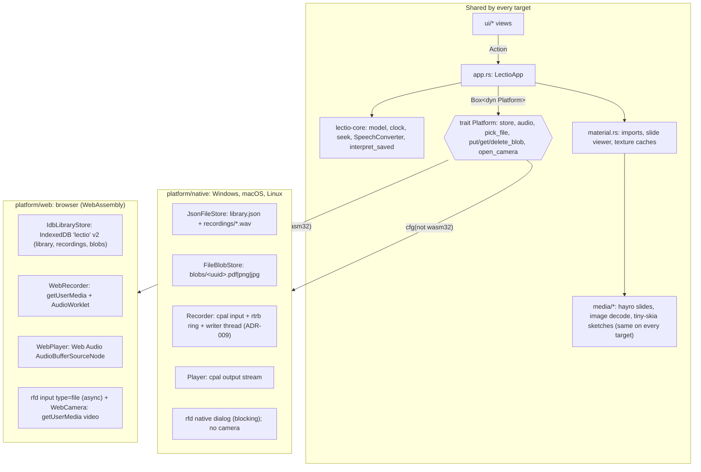

| Trait (`src/platform/mod.rs`) | Native (`platform/native/`) | Web (`platform/web/`) |
|---|---|---|
| `LibraryStore` (in `lectio-core`) | `JsonFileStore`: atomic file save | `IdbLibraryStore`: read before start, saves queued in the background |
| `AudioCapture` | `Recorder` (cpal, lock-free ring) | `WebRecorder` (`AudioWorklet` batches → `SpeechConverter`) |
| `AudioPlayback` | `Player` (cpal output, sample position) | `WebPlayer` (`AudioBufferSourceNode`, `AudioContext.currentTime`) |
| time "now" (`now_unix_ms`) | `SystemTime` | JavaScript `Date.now()` |
| `Platform::pick_file` (Phase 2) | `rfd::FileDialog`, blocks while open (audio threads keep recording) | `rfd::AsyncFileDialog` → `Pending` |
| `put_blob` / `get_blob` / `delete_blob` | `FileBlobStore` (`lectio-core`), atomic write | IndexedDB table `blobs`, queued writes |
| `open_camera` → `CameraSession` | `None` (file picker instead, ADR-013) | `WebCamera`: `<video>` + off-screen canvas, JPEG snapshot |
| slide rendering (not a trait: same code) | `DeckRenderer` on a background thread | `DeckRenderer`: one page per frame on the main thread |
| `SpeechService` (Phase 3) | Whisper on a thread | Whisper in a Web Worker |
| `StudyModel` (Phase 4a, ADR-021) | one thread: Qwen (candle), Ollama, endpoint (`ureq`) | Qwen in a second Web Worker; Ollama / endpoint with `fetch` |
| `DictionaryService` (Phase 4a, ADR-022) | thread; index file in `dictionary/` | index built in a short-lived worker, kept in IndexedDB |
| `load_secret` / `save_secret` (the endpoint key) | `secrets.json`, permissions 0600 | `localStorage`, this page's address only |
| `save_file` / `print` (Phase 4b, ADR-025) | save dialog (`rfd`); PDF opened in the system viewer | download (`<a download>`); HTML printed from a hidden frame |
| screen readers (Phase 4b, ADR-027) | AccessKit → the OS (eframe) | `web::a11y` plugin: AccessKit tree → hidden DOM overlay |

Browser APIs are asynchronous; the traits are synchronous because egui redraws every frame. So the web side starts work with
`wasm_bindgen_futures::spawn_local` and the app checks results each frame: `is_ready()`, `take_error()`,
`take_background_error()`, and `Pending::take()` for file picks and blob reads (native returns `Pending::ready` at once).

## Folder structure
```
lectio/
├── Cargo.toml                 # workspace root + the `lectio` app; dependencies split by target
├── index.html, Trunk.toml     # web build (trunk build --release → dist/)
├── web/lectio-capture-worklet.js  # browser audio-thread code for recording
├── .github/workflows/ci.yml   # CI: ubuntu/windows/macos + web; Phase 4b: desktop screenshots (xvfb, WARP), audio
│                              #   self-test, browser screen-reader flow (advisory)
├── .github/workflows/release.yml  # Phase 4b: on v* tags, .dmg / .msi + .zip / AppImage / web zip → GitHub release
├── .cargo/config.toml         # WebAssembly SIMD for browser builds (P-035)
├── tools/web-smoke.mjs        # headless-Chrome test driver; flows phase2 (CI, incl. PDF/DOCX export), a11y (CI:
│                              #   accessibility tree, screen-reader clicks, Tab order), phase3 / phase4a (local)
├── tools/package/             # Phase 4b: macos.sh (.app + .dmg), windows.ps1 + lectio.wxs (.zip + .msi),
│                              #   linux-appimage.sh, web.sh; used by release.yml and runnable locally
├── assets/sample-slides.pdf   # 2-page deck for sample data, tests and the browser flow
├── assets/fonts/              # Inter, JetBrains Mono, Noto Sans Math (OFL), Phosphor icons (MIT); sources in README.md
├── assets/icon/               # Phase 4b: lectio-icon.png (drawn by src/media/icon.rs) for the installers
├── crates/lectio-core/        # pure domain logic: no UI, no audio I/O, no platform code
│   ├── src/
│   │   ├── lib.rs             # public API, MAX_NAME_CHARS
│   │   ├── model.rs           # Library → Course → Session → Note; immutable `with_*` changes
│   │   ├── labels.rs          # LabelKind (fixed identity) + LabelSet (renameable names)
│   │   ├── ids.rs             # CourseId / SessionId / NoteId (typed UUIDs)
│   │   ├── error.rs           # ModelError with plain-English messages
│   │   ├── timeline.rs        # seek maths: ms ↔ samples ↔ timeline fraction, active note
│   │   ├── clock.rs           # RecordingClock state machine + NoteDraft (anchor = start of typing)
│   │   ├── resample.rs        # downmix, Downsampler (→16 kHz), SpeechConverter (chunk-safe), float→i16
│   │   ├── realtime.rs        # integer maths used on the audio thread: ring size, whole-frame writes
│   │   ├── material.rs        # Phase 2: BlobKey, MediaKind/check_file, SlideDeck, SlideLink, Attachment, orphaned_blobs,
│   │   │                      #   with_slide_item / with_note_text (slides posted to the feed)
│   │   ├── stream.rs          # audio stream: 10 s sections, section_at, section_labels (tint per section)
│   │   ├── trash.rs           # live/trashed sessions, trash + restore, 30-day expiry
│   │   ├── prefs.rs           # Preferences: panels, theme, speed, filters, captions, speech model + language
│   │   ├── export.rs          # session_markdown: headings, notes, slides, labels → Markdown
│   │   ├── transcript.rs      # Phase 3: Segment/Transcript, window alignment, next window, merge, segment_at
│   │   ├── search.rs          # Phase 3: fold, word/prefix matching, ranking, snippets, search_deck, with_slide_text
│   │   ├── dsp.rs             # Phase 3: analyse, biquads, expander, normalise gain, FilterChain, with_cleaned_copy
│   │   ├── stretch.rs         # Phase 3: speed steps, skip, time left, TimeStretcher (WSOLA)
│   │   ├── sources.rs         # Phase 4a: numbered sources ([S12] (17:05) text), chunking under a token budget,
│   │   │                      #   citation parsing + mapping, best_match (cite by shared words)
│   │   ├── prompts.rs         # Phase 4a: outline / quiz / card prompts with worked examples; token budgets
│   │   ├── outline.rs         # Phase 4a: Outline, parse_outline, merge, outline → Heading notes
│   │   ├── quiz.rs            # Phase 4a: questions, parsing, cloze fallback, grading, topics, attempts
│   │   ├── cards.rs           # Phase 4a: flashcards, SM-2 scheduling, due cards
│   │   ├── tasks.rs           # Phase 4a: Task notes across courses, done / due date, filters
│   │   ├── focus.rs           # Phase 4a: FocusTimer (pause/resume), focus log per course
│   │   ├── dictionary.rs      # Phase 4a: WordNet line parsing, compact index, base forms, online provider trait
│   │   ├── collections.rs     # Phase 4b: Collection, add/remove sessions, HomeFilter + SessionSort, home_sessions
│   │   ├── ink.rs             # Phase 4b: InkStroke / PageInk on a deck, checks + rounding, eraser hit test, undo
│   │   ├── math.rs, math/     # Phase 4b: LaTeX subset parser (parse.rs, symbols.rs) + box layout (typeset)
│   │   ├── paper.rs           # Phase 4b: the paper view's blocks, pictures needed, Markdown writer
│   │   └── storage.rs         # LibraryStore, interpret_saved, JsonFileStore, FileBlobStore (atomic writes)
│   └── tests/                 # model, material, workflow, transcript, search, audio DSP, seek, clock, storage,
│                              #   resample, capture pipeline, study (chunking, citations, quiz), review (SM-2,
│                              #   tasks, focus, dictionary, v4 → v5), organize (collections, Home filter, v5 → v6),
│                              #   polish (ink, formulas, paper blocks, Markdown)
├── crates/lectio-speech/      # Phase 3 (ADR-016): Whisper on candle, no platform code
│   └── src/                   # mel.rs (spectrogram), tokenizer.rs (tokens → text, languages), models.rs (files,
│                              #   pinned revisions, SHA-256), engine.rs (one 30 s window), job.rs (window stepper,
│                              #   captions), protocol.rs (page ↔ worker messages); 13 tests
├── crates/lectio-llm/         # Phase 4a (ADR-021): Qwen2.5-Instruct (GGUF) on candle, no platform code
│   └── src/                   # models.rs (files, pinned revisions, SHA-256), engine.rs (chat template, greedy
│                              #   decoding with a repeat penalty), protocol.rs (page ↔ study worker messages)
├── crates/lectio-export/      # Phase 4b (ADR-025): paper blocks → HTML (print), DOCX (hand-written OOXML), PDF
│                              #   (krilla); tests read the files back (zip, hayro)
├── crates/lectio-worker/      # the browser's Web Worker (wasm only; empty on desktop): Whisper (Phase 3), and in a
│                              #   second copy the study model and the dictionary index (Phase 4a, study.rs)
├── src/
│   ├── main.rs                # module list + two `main`s, picked by target
│   ├── entry_native.rs        # native: args (--screenshot, --self-test-audio, --transcribe), window options
│   ├── entry_web.rs           # web: open IndexedDB, start egui on the canvas, #sample
│   ├── app.rs                 # LectioApp: owns state, applies Actions, saves through `dyn Platform`
│   ├── app/material_actions.rs # Phase 2 actions: imports, camera, sketch, viewer, reading view
│   ├── app/ui_state.rs        # undo for deletes (8 s), level-meter history, silence timer
│   ├── app/workflow.rs        # screens, trash, posting slides, saved layout/theme, Copy all / Export Markdown
│   ├── app/speech_actions.rs  # Phase 3: transcription, model download, live captions, search, opening a result
│   ├── app/audio_actions.rs   # Phase 3: speed, filters, cleaned copy, recording source, screenshots
│   ├── app/study_actions.rs   # Phase 4a: AI provider, jobs (outline/quiz/cards over chunks), quiz and review runs
│   ├── app/organize_actions.rs # Phase 4a: tasks, focus timer, word look-up
│   ├── app/paper_actions.rs   # Phase 4b: formula mode, paper options, export/print job (one picture per frame)
│   ├── app/ink_actions.rs     # Phase 4b: drawing tools, add/erase/undo/clear strokes
│   ├── app/collection_actions.rs # Phase 4b: collections, Home filter and sort
│   ├── action.rs              # Action enum: everything the UI can ask for
│   ├── material.rs            # Phase 2 runtime state: pending imports, Viewer, image/slide texture caches, camera
│   ├── media/                 # slides.rs (hayro, DeckRenderer: pages + text), slide_text.rs (text device),
│   │                          #   images.rs (EXIF-upright decode, JPEG), sketch.rs (PNG); Phase 4b: math.rs (formula →
│   │                          #   image with ab_glyph + tiny-skia), ink.rs (strokes over a page → PNG), icon.rs, fonts.rs
│   ├── platform/
│   │   ├── mod.rs             # traits Platform / AudioCapture / AudioPlayback / CameraSession, Pending, FileKind,
│   │   │                      #   CaptureSource
│   │   ├── speech.rs          # SpeechService trait, SpeechRequest / SpeechEvent
│   │   ├── ai.rs              # Phase 4a: StudyModel trait, AiRequest (key hidden in Debug), Ollama / OpenAI bodies
│   │   ├── dictionary.rs      # Phase 4a: DictionaryService trait, the pinned WordNet download
│   │   ├── a11y_map.rs        # Phase 4b: AccessKit node → HTML role, name and state (tested on desktop)
│   │   ├── wav.rs             # WAV bytes ↔ samples (shared; 2 unit tests)
│   │   ├── native/            # mod.rs (NativePlatform: data folder, rfd, FileBlobStore, xcap), recorder.rs (mic +
│   │   │                      #   loopback, mixing), player.rs (stretcher + filters), speech.rs (thread, CLI),
│   │   │                      #   fetch.rs (checked downloads, JSON POST), ai.rs (study thread, --ai-benchmark),
│   │   │                      #   dictionary.rs (thread), secrets.rs (0600 file)
│   │   └── web/               # mod.rs (WebPlatform, localStorage key), idb.rs, store.rs, recorder.rs, player.rs,
│   │                          #   files.rs, camera.rs, display.rs (getDisplayMedia), fetch.rs (checked downloads into
│   │                          #   a JS buffer, JSON POST), speech.rs (speech worker), ai.rs (study worker, Ollama,
│   │                          #   endpoint), dictionary.rs (index built in a short-lived worker); Phase 4b: a11y.rs
│   │                          #   (screen-reader DOM overlay plugin), print from a hidden frame
│   ├── ui/                    # views (see "Screens and workspace"): theme (tokens), widgets, icons, format,
│   │                          #   nav (left column), home (Home/Collections/Trash), search (Search page),
│   │                          #   workspace (panels, Layout menu, tabs, caption strip), slides, notes (feed),
│   │                          #   stream (Audio | Transcript | Outline tabs), transcript, capture + playback + composer
│   │                          #   (input bar), timeline, reading, sketch, camera, screen_crop, labels (rename window);
│   │                          #   Phase 4a: outline, study (cards, quiz, focus), tasks, define (look-up window),
│   │                          #   ai_settings; Phase 4b: formula (preview + textures), ink (paint, tools, input), collections,
│   │                          #   reading = the paper view
│   ├── demo.rs                # sample data with slides + a sketch (--screenshot, web #sample)
│   ├── self_test.rs           # native only: headless mic test
│   └── screenshot.rs          # native only: draws 120 frames, saves a PNG, exits
├── docs/                      # design docs: architecture, decisions, problems
└── shots/                     # screenshots
```

## Data model (implemented; schema version 6)
The diagram shows versions 1–4; the Phase 4a (v5) additions are drawn separately below it.
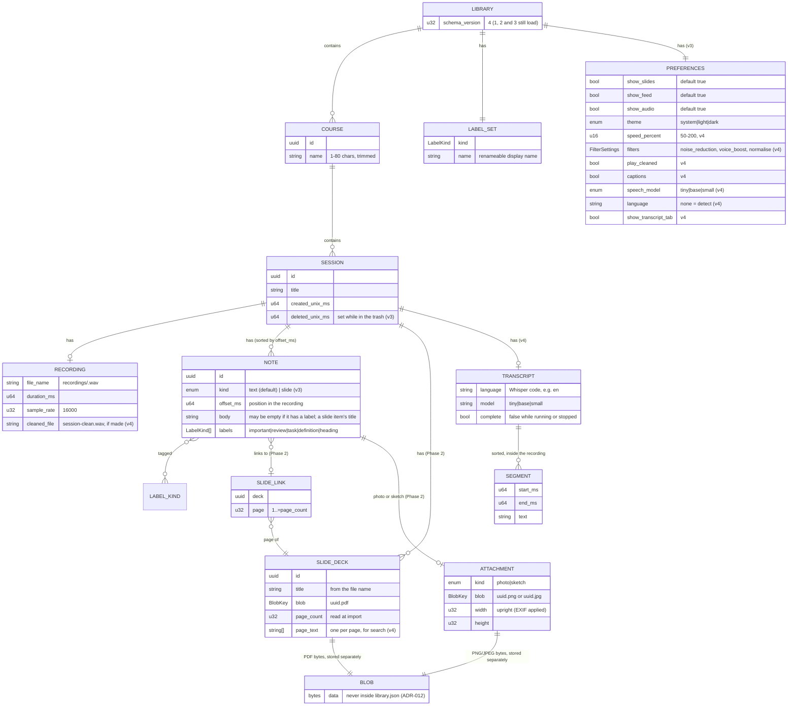

Schema version 5 (Phase 4a): study data. Every new field has a default and is left out of the JSON when empty, so a v4
file loads unchanged (`a_version_4_library_loads_with_no_study_data`).
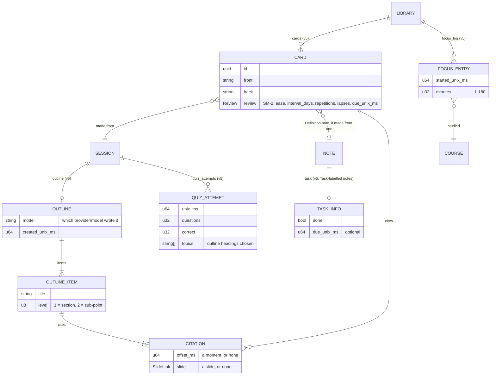
`Preferences` gains `ai` (`none | local {small|large} | ollama {model} | open_ai {base_url, model}`; never the key),
`online_dictionary` (off by default) and `show_outline_tab`. Rules (tested in `tests/study_tests.rs` and
`tests/review_tests.rs`): a citation can only come from a source that was actually sent to the model (unknown source
numbers are ignored, and an item left with no citation is dropped); a card's front and back can't be blank; only
Task-labelled notes take a done state or a due date; a focus entry needs an existing course and at least one minute (the
timer offers 1–180); due flashcards only count for sessions that aren't in the trash.

Schema version 6 (Phase 4b): collections, slide ink and formula notes. A v5 file loads unchanged
(`a_version_5_library_loads_with_no_collections_ink_or_formulas`).
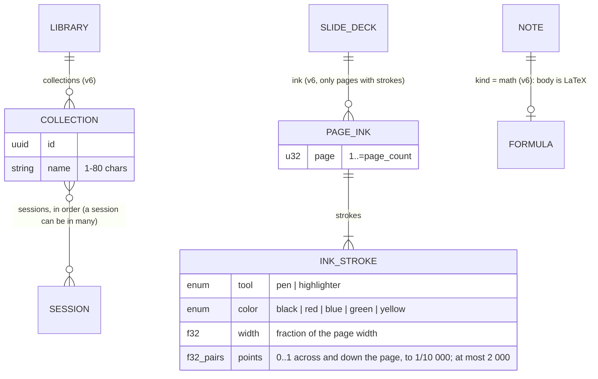
`Preferences` gains `home_filter` (`all | course | collection | label`) and `home_sort` (`newest | oldest | title |
longest`). Rules (tested in `tests/organize_tests.rs` and `tests/polish_tests.rs`): a collection lists each session once;
adding a session that doesn't exist fails; trashed sessions stay in a collection but are hidden, and leave it when they
are removed for good; a stroke needs 1–2 000 points inside the page and a page at most 500 strokes; the eraser removes
whole strokes within its reach; a formula note must parse (the same check applies when it is edited).

Rules enforced by `Library` (tested in `tests/model_tests.rs` and `tests/material_tests.rs`): names can't be blank or longer
than 80 characters; a note needs text, a label or an image; notes of every kind stay sorted by `offset_ms` (linking a slide
never moves a note); a note can't be placed after the end of an existing recording; a session gets one recording; a slide link
must point at an existing page of a deck *in the same session*; removing a deck removes the links to it, not the notes;
`BlobKey`s are only `<canonical uuid>.<pdf|png|jpg>`, checked again when `library.json` is read (no `../` path tricks);
imported files are recognised by their first bytes, with 100 MB (PDF) and 25 MB (image) limits; a file with a newer
`schema_version` is refused. Since v3 (tested in `tests/workflow_tests.rs`): a slide item must link to an existing page and
its title falls back to "Slide N" when cleared; a trashed session is hidden from every list except Trash and is removed for
good 30 days after `deleted_unix_ms`; every new field has a default, so v2 files load unchanged. Since v4 (tested in
`tests/transcript_tests.rs` and `tests/search_tests.rs`): a transcript needs a recording and its segments must be in order
and inside the recording; `page_text` has exactly one entry per page; a cleaned copy's name is letters, digits, `-`, `_`
and `.wav` only; v3 files load with no transcripts, normal speed and no filters.

Where the data lives (same JSON format and same WAV format on every platform):
```
Native: the OS app-data folder (macOS ~/Library/Application Support/org.Lectio.Lectio,
        Windows %APPDATA%\Lectio\Lectio\data, Linux ~/.local/share/lectio), or $LECTIO_DATA_DIR
  library.json                  # the whole Library, pretty-printed JSON (small: no file bytes)
  recordings/<session-id>.wav   # 16 kHz, mono, 16-bit PCM
  blobs/<uuid>.pdf|png|jpg      # Phase 2: slide decks, photos (as picked), sketches (PNG)
  recordings/<id>-clean.wav     # Phase 3: a cleaned copy, if the user made one
  models/whisper-<size>/        # Phase 3: config.json, tokenizer.json, model.safetensors (checked by SHA-256)
  models/qwen2.5-<size>-instruct/  # Phase 4a: model.gguf, tokenizer.json (checked by SHA-256)
  dictionary/wordnet-index.tsv  # Phase 4a: the compact dictionary index (the 49 MB download is deleted after)
  secrets.json                  # Phase 4a: the endpoint key, readable by this user only (0600); never in library.json

Web: IndexedDB database "lectio" (version 3) in the browser, per site
  table "library":    key "library.json"      → the same JSON text
  table "recordings": key "<session-id>.wav"  → the same WAV bytes
  table "blobs":      key "<uuid>.pdf|png|jpg" → the file's bytes (added by the v1→v2 upgrade; v1 data is kept)
  table "models":     key "whisper-<size>/<file>" → a speech-model file (added by the v2→v3 upgrade)
                      key "qwen2.5-<size>-instruct/<file>" → a study-model file (Phase 4a)
                      key "wordnet-index.tsv" → the dictionary index (Phase 4a)
localStorage: "lectio-secret:openai-compatible" → the endpoint key (Phase 4a)
```

## Phase 2 flows

### Import slides → see them beside the notes → link notes
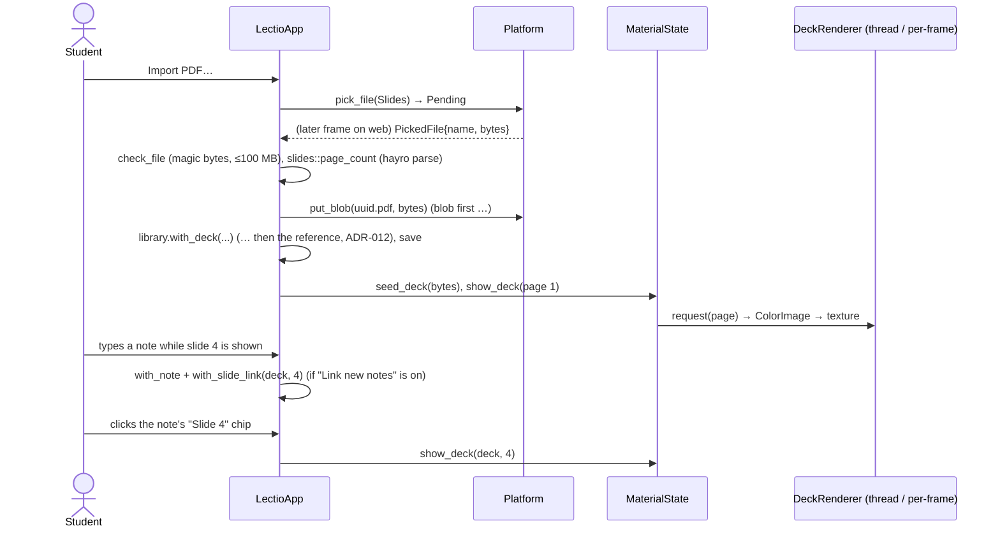

### Photo / camera / sketch → image note on the timeline
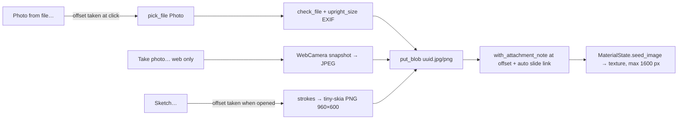
Deleting a note or deck → `orphaned_blobs(before, after)` → `delete_blob` for each, after the library is saved.

### Reading view
The toolbar's **Reading view** toggle replaces the workspace with `ui/reading.rs`: the session as a document in timeline
order, with larger text, headings as section titles, labels, "Slide N · deck" for linked notes, posted slides at column
width, and photos and sketches inline. There is no audio. "Copy all" and "Export Markdown" produce the text from
`lectio_core::export::session_markdown`.

## Main flows

### Record → note → stop
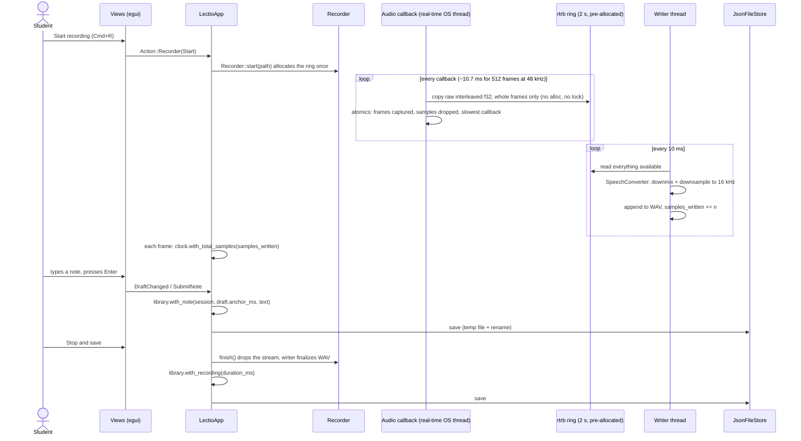
Pause sets a flag the audio callback checks; paused audio is dropped, so pauses add no samples and no time (ADR-006).
Closing the window mid-recording runs the same `finish_recording` path, so the audio and duration are kept.

### Record → stop in the browser (same app code, `platform/web`)
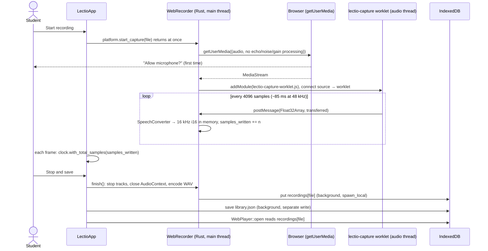
IndexedDB runs read-write work on the *same* table in the order it was started, so the player's read of `recordings[file]`
always sees the audio that was just written. The library and the audio are different tables, so their two writes are not
ordered against each other: if the tab is closed in the split second between them, the session can say "recorded" while the
audio is missing, and the player then reports "The audio for this session is not in this browser's storage."

### Playback → click a note → seek
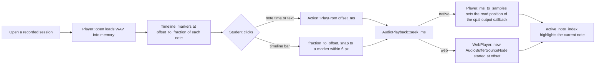

### Planned (later phases)
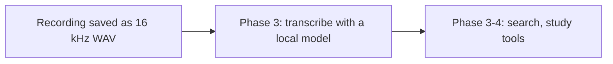

## Threads (native)
In the browser, all Rust code runs on the page's main thread; only the recording worklet (JavaScript) runs on the browser's
audio thread and talks to Rust through `postMessage`.

| Thread | Owns | Talks to others via |
|---|---|---|
| UI (main) | `LectioApp`, `Library`, cpal `Stream` handles | reads `samples_written` and `Recorder::stats()` atomics; `Mutex<PlayState>` |
| Audio input callback (**real-time**) | `rtrb::Producer<f32>` | writes raw samples into the ring; only atomics otherwise. No allocation, no locks, no blocking (ADR-009) |
| WAV writer | `rtrb::Consumer<f32>`, `SpeechConverter`, `hound::WavWriter` | polls the ring every 10 ms; bumps `samples_written`, `peak` |
| Audio output callback (**real-time**) | read-only `Arc<[i16]>` samples | `try_lock` on `PlayState` (plays silence instead of waiting) |

*Real-time thread:* a thread the OS runs at high priority with a hard deadline per audio buffer; if the code on it waits for
anything (memory allocator, a lock, the disk), the deadline can be missed and audio glitches (PROBLEMS P-007).

## Accessibility (Phases 1–2)
- Phase 2: slide images and photos carry alt text ("Week 3, slide 4 of 32", "Photo", "Sketch"), the sketch canvas reports
  itself as a canvas, slides turn with Page Up / Page Down, and every Phase 2 action is a labelled button. The reading view
  uses larger text (18 pt). Drawing a sketch needs a pointer (mouse, trackpad, pen or touch), so it has no keyboard equivalent.
- **Desktop:** every control is a labelled egui widget; eframe's AccessKit integration hands them to the OS screen reader
  (AccessKit supports macOS, Windows and Linux). Not yet tried with a real screen reader. The timeline reports itself as a
  slider ("Recording position 17:40 of 50:00").
- **Web: known gap (P-013).** egui draws on one `<canvas>`, and eframe 0.37 has no AccessKit bridge to the browser's
  accessibility tree, so screen readers can't read the web version yet. Typing and Enter were verified in the browser test;
  Tab navigation and browser zoom were not tested there.
- Keyboard: Tab moves focus; Cmd/Ctrl+R start/pause/resume recording or play/pause; Cmd/Ctrl+Shift+R stop; Cmd/Ctrl+1–4 label the
  moment (Important, Review, Task, Definition) and Cmd/Ctrl+5 saves the typed text as a Heading; Cmd/Ctrl+Shift+N posts the
  next slide; Esc leaves full-screen slides; Cmd/Ctrl+[ and ] skip ±10 s; Cmd/Ctrl+Shift+, and . change the playback
  speed; with the timeline focused, ←/→ skip ±10 s and Home/End jump to the ends.
- Navigation items report themselves as tabs with a selected state; audio sections are buttons named "Play from 0:10".
- Zoom: Cmd/Ctrl + and − (eframe built-in); panels scroll and wrap, so 200% stays usable.
- Label chips use near-black text on light fills (contrast above 7:1), always show the label name, and labelled timeline markers have
  a flag shape, so colour is never the only signal.

## Known limitations (Phases 1–2)
- Phase 2: no camera in the desktop apps (ADR-013); photos come from the file picker.
- Phase 2: PDFs that are password-protected can't be opened (hayro limit, ADR-011); very large, image-heavy decks are untested
  and may render slowly, especially in the browser, where a page renders on the main thread.
- Phase 2: if an import is interrupted after its blob is stored but before the library saves, an unused blob stays behind;
  orphan clean-up only runs on delete (ADR-012).
- The audio stream uses fixed 10-second sections, not sections split at pauses (ADR-015).
- Page search in the slides panel and the "Computer audio" / "Both" sources are placeholders until Phase 3; Tasks is a
  placeholder until Phase 4; there is no print yet (Markdown export only).
- If the app crashes (not a normal close) during recording, the WAV header isn't finalized; the notes are safe (saved on every
  change) but the audio file needs repair. A recovery step is a candidate for a later phase.
- One recording per session; no "record more" after Stop.
- The whole recording is loaded into memory for playback (~115 MB per hour).
- Live microphone capture is checked with `lectio --self-test-audio <seconds>` on a real machine, not in automated tests
  (PROBLEMS P-005, P-007).
- If the writer thread stalls for more than 2 s (the ring size), samples are dropped; the capture view then shows how much.
- Web: the recording is kept in memory until Stop (≈115 MB per hour) and then stored in IndexedDB; a tab crash mid-lecture
  loses that audio (notes are safe). Up to one worklet batch (≈85 ms) at the very end is not saved. Browsers may clear a
  site's storage under disk pressure unless it is marked persistent (`navigator.storage.persist()`, not requested yet).
- Web: tested in headless Chrome only (fake microphone); Safari and Firefox are untested (ADR-010).

## Design system (ADR-014)
The layout is described in "Screens and workspace" below; this section covers the look.

- **Tokens:** every colour, size, spacing and radius comes from `ui/theme.rs` (light + dark `Palette`, `label_colors`, type
  scale 12/13/15/18/24, spacing 4–32, radius 6/10). A unit test checks WCAG AA contrast for all text and marker pairs.
- **Fonts:** Inter (text), JetBrains Mono (timestamps only), Phosphor (icons) in **separate families**; mixed icon + text is
  built with `widgets::icon_text` (PROBLEMS P-018).
- **Controls:** `ui/widgets.rs`: icon buttons (tooltip + accessible name), primary/subtle buttons, time pills, label and neutral
  chips, a switch, cards, empty states, and label marker shapes (diamond/circle/square/triangle) so labels never differ by
  colour alone.
- **Names for tests:** `widgets::name` gives a control its accessible name and records `(name, rect)` for the frame; the web
  build publishes them as `window.__lectioWidgets` when the URL has `#test` (P-020).
- **Safety:** deleting a note or slide deck shows an **Undo** toast for 8 s (`ui_state.rs`). The library value from before
  the delete is kept (it's immutable, ADR-007), and orphaned files are deleted only after the undo window closes.
- **Empty states:** no course → "Add a course"; no sessions → a hint to press "New session"; no slides → "Import PDF";
  all panels hidden → "Show the feed". One primary action each.
- **Reading view:** a centred 720 px column, 17 px text with 27 px line height; headings as section titles and posted
  slides at column width; "Copy all" and "Export Markdown" at the top.

## Screens and workspace (ADR-015)
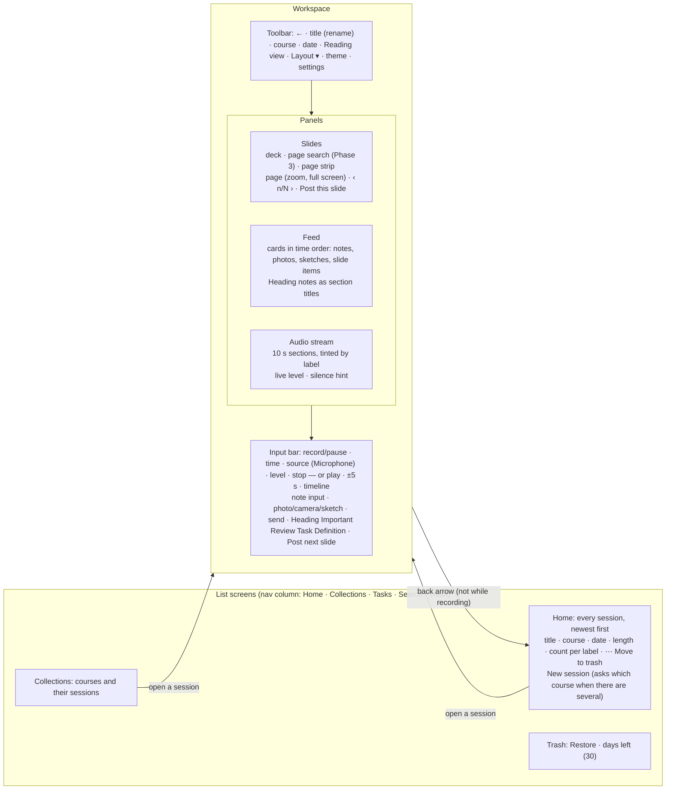
- **Layout:** the Layout menu hides Slides, Feed or Audio (saved in `Library.preferences`). With the feed hidden, the slides take
  the middle. Below 900 px the workspace shows one panel at a time, picked with tabs; the input bar stays.
- **Feed:** cards are at most 760 px wide. During playback the item playing is highlighted and scrolled into view when it
  changes (PROBLEMS P-022); during recording the feed sticks to the newest item.
- **Audio stream:** `audio_sections(duration)` gives the sections; `section_labels` gives each one's tint; `section_at` the
  playing one. Clicking a section plays from its start. While recording, the column grows and a level bar shows sound
  arriving; after 10 s below the silence level a hint suggests checking the microphone.

### Record with slides → the feed fills in
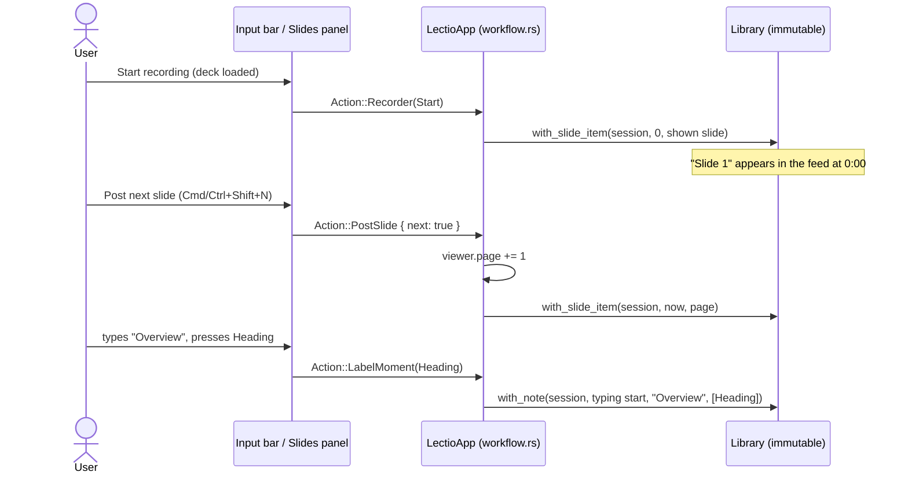

### Trash → restore or expire
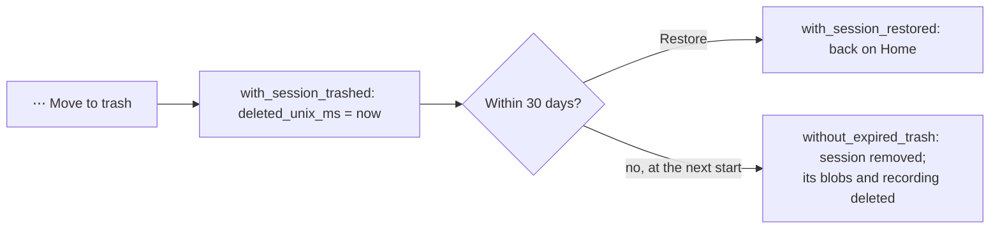

## Phase 3: text and audio

### Transcribe a recording (ADR-016)
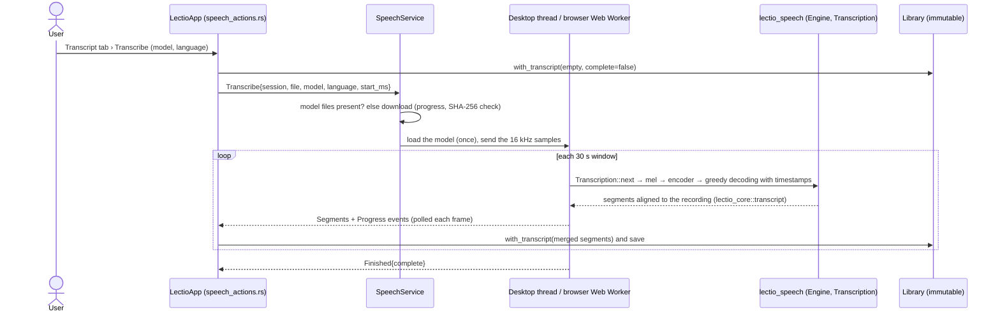
- **Stop** sets a flag the loop checks between windows; what is done stays, and "Continue transcribing" starts after the
  last finished segment.
- **Live captions:** every 2 s while recording, `AudioCapture::recent_audio(8 s)` → `Caption` request → the same engine →
  the caption strip above the input bar. Desktop recorders keep the last 30 s for this.
- **Desktop CLI:** `lectio --transcribe file.wav --model tiny|base|small [--language xx]` prints segments and the real-time
  factor (the numbers in ADR-016).

### Playback: speed and filters (ADR-017)
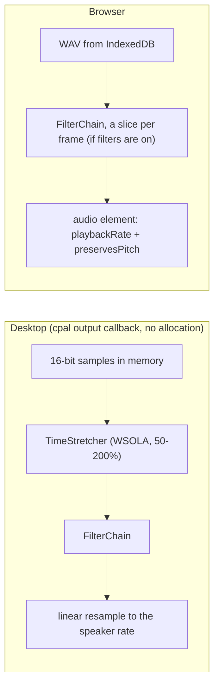
"Save cleaned copy" runs the same `FilterChain` over the whole recording and stores `<session>-clean.wav`; playback then
uses it, with the live filters off.

### Recording sources and screenshots (ADR-019)
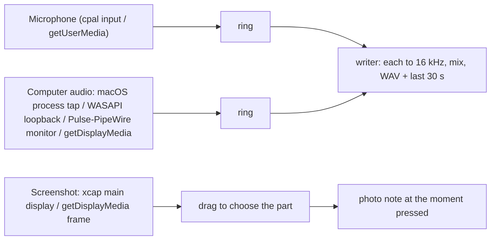

### Search (ADR-018)
The Search page calls `lectio_core::search::search(library, query, 60)` when the text changes and when the page opens. Each
hit carries the session, the moment and the slide; opening it selects the session, seeks, and shows the slide. Slide text is
read once per deck (`media/slide_text.rs`) into `SlideDeck.page_text`; the slides panel's box lists matching pages
(`search_deck`).

### Phase 3 accessibility
New controls have accessible names: "Speech model", "Spoken language", "Transcription progress", "Play from 0:12" (each
segment), "Search everything", "Search slides", "Audio source", "Live captions", "Sound filters", "Playback speed",
"Screenshot area". The caption strip uses large text (18 px).

### Phase 3 known limitations
- No speaker separation (ADR-020). Live captions need the model downloaded first and lag about 2 s behind.
- The tiny model mishears technical words; base and small are better but slower (numbers in ADR-016).
- Small is desktop-only (browser tab memory). Since Phase 4a the browser build uses WebAssembly SIMD (P-035).
- Computer audio: macOS 14.2+ and permission; Firefox and Safari can't share tab sound; if the default output device also
  has a microphone, macOS records that microphone instead.
- Slide text: decks from before Phase 3 are read the first time their session opens; scanned (image-only) PDFs have none.
- Search scans everything each time: fine for a few terms of lectures, would need an index for much more.

## Phase 4a: study
Every AI feature goes through one trait, `StudyModel` (ADR-021), and every generated item carries citations (a moment
and/or a slide) that seek the recording or open the slide when clicked. With no provider set, the Outline tab and the
"with AI" buttons are not drawn; flashcards and the quiz still work from Definition notes.

### Write an outline (the same pipeline makes AI quizzes and flashcards)
```mermaid
sequenceDiagram
  participant UI as ui/outline.rs
  participant App as app/study_actions.rs
  participant Core as lectio-core (sources, prompts, outline)
  participant M as StudyModel (thread / worker / Ollama / endpoint)
  UI->>App: Action::GenerateOutline
  App->>Core: sources::gather(session) → numbered sources<br/>(notes, slide text, transcript; time order)
  App->>Core: chunk(sources, 1500 tokens) → at most 8 chunks (even sample)
  loop each chunk, one request at a time
    App->>Core: prompts::outline(chunk) → system + user text
    App->>M: AiRequest::Complete {id, provider, key only for an endpoint}
    M-->>App: AiEvent::Downloading… / Ready (local, first use)
    M-->>App: AiEvent::Reply {id, text}
    App->>Core: parse_outline(text, chunk.sources)<br/>[S12] → moment/slide; no marker → best_match; no source → dropped
  end
  App->>Core: merge_outlines → Library::with_outline (saved)
  UI->>App: click a citation → Action::PlayFrom(ms) / open the slide
  UI->>App: "Add to feed as headings" → with_outline_headings (Heading notes at each time)
```
Each request waits for the previous one, so a long lecture shows "part 2 of 5" and one failure stops the job with a
message instead of leaving half a result. Quizzes split the requested number of questions across chunks (`spread`);
flashcards ask for up to 5 per chunk.

### Where the local model runs
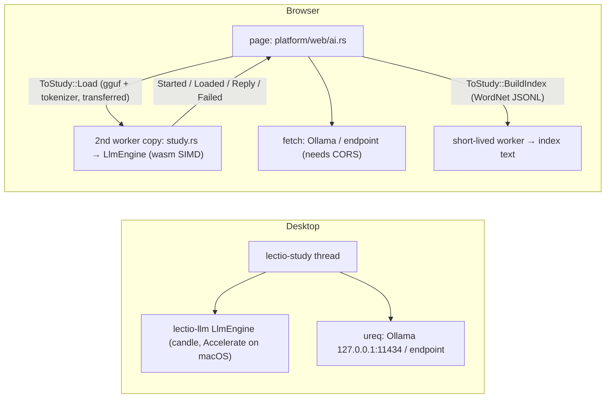
A worker can lose messages sent before its program has loaded, so every worker copy first posts `Started` and the page
waits for it. If the study worker dies (usually out of memory), its `error` event fails every request it was holding,
so the app never waits forever, and the next request starts a fresh worker.

### Quiz, flashcards, tasks, focus, definitions
- **Quiz** (`ui/study.rs`): pick one session or a whole course, the number of questions and topics (the outline's
  headings, or all). With AI: multiple choice and short answer, each with an explanation and citations. Without AI (or
  with the switch off): fill-in-the-blank questions from Definition notes written as "Term: meaning". Typed answers are
  right if they contain every word of the expected answer (case, accents and punctuation ignored). The score is saved
  on each session the questions came from (`QuizAttempt`).
- **Flashcards**: "Make cards from Definition notes" (no AI, one card per note, never duplicated) and "Write cards with
  AI". Review shows the front, then the back, and the user grades Again / Hard / Good / Easy; SM-2 sets the next due
  date (`cards::review`). Home shows the number of cards due.
- **Tasks** (Tasks page): every Task-labelled note in live sessions (open ones first, then by due date with undated
  last, then newest session and time in the lecture), filterable by course
  and done state; ticking it done or setting a due date stores a `TaskInfo` on the note; "jump" opens the session at
  that moment.
- **Focus timer**: choose a course and minutes; a chip in the toolbar shows the time left on every screen, with
  pause / resume. Finishing logs a `FocusEntry` (the minutes actually spent); cancelling logs nothing.
- **Definitions**: double-click a word in a note or the transcript → the look-up window tries the offline index (base
  forms: plurals, -ing, -ed), then, only if the user allowed it, dictionaryapi.dev. "Add to feed" makes a Definition
  note at the current moment ("word: meaning"), which then feeds flashcards and the offline quiz.

### Phase 4a known limitations
- The 0.5B model writes simple outlines and questions; subtle questions need the 1.5B model, Ollama or an endpoint. In the
  browser it runs at about 8 tokens/s (about 60 on an M2 desktop), so an outline takes a minute or two, and its titles
  are sometimes whole sentences instead of short headings.
- An outline needs about 600 characters of material; shorter sessions get a message instead (P-036).
- In the browser, Ollama only answers pages it allows (by default `localhost` pages), and an endpoint must send CORS
  headers. The browser key lives in `localStorage`, which any script on the same page address could read; Lectio loads
  no third-party scripts.
- The dictionary is English only. Look-ups don't handle irregular forms ("went" → "go").
- A running job (outline, AI quiz, AI cards) can't be cancelled; it runs to the end or stops at the first error.

## Phase 4b: polish and ship

### A formula note: LaTeX → preview → feed, paper view and exports (ADR-023)
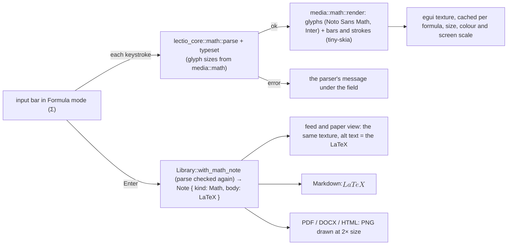
Layout is TeX's idea in small: every piece is a box with a width, an ascent and a descent; rows add widths with spacing by
class (operators and relations get medium and thick spaces); scripts are smaller and shifted; fractions stack around the
math axis with a bar; roots, accents and `\left…\right` brackets are drawn or scaled to the contents.

### Drawing on a slide (ADR-024)
The slide panel's pen button turns drawing on and shows pen, highlighter, eraser, five colours, undo and clear. A drag
over the page collects points as page fractions in `Buffers::ink_stroke` and draws them live; pen-up sends
`Action::AddInkStroke`, and `Library::with_ink_stroke` checks and rounds them into the deck's `PageInk`. The eraser sends a
point; every stroke within its reach is removed. The same strokes are painted by egui over the page in the slides panel,
full screen, the feed's slide thumbnails and the paper view, and by tiny-skia onto the rendered page for exports
(highlighters first, at 38% opacity, so pen strokes stay on top).

### Paper view → Copy, Print, Export (ADR-025)
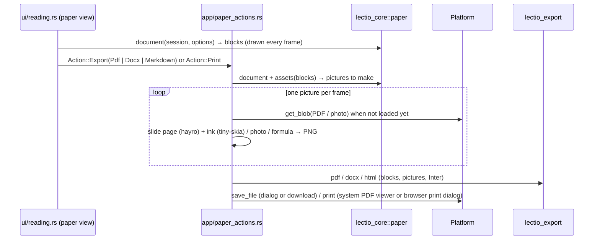
Copy puts the Markdown of the same blocks on the clipboard. The browser test exports a recorded lecture as PDF (140 KB)
and DOCX (100 KB) and checks the files.

### Collections and the Home list (ADR-026)
Home shows `Library::home_sessions(filter, sort)`; the filter and sort menus change the saved preferences. Each session's
"⋯" menu has a tick per collection and "New collection with this session…". The Collections page lists each collection
(rename, delete) and then each course; sections are separate id scopes, because one session can appear in several
(P-040). "Quiz me" accepts a collection.

### Screen readers in the browser (ADR-027)
```mermaid
flowchart LR
  E["egui frame"] -->|"output_hook: AccessKit TreeUpdate"| M["a11y_map::mirror → Spec per readable node"]
  M --> D["#lectio_a11y overlay: button / input / role=… elements with aria-* state, positioned like the widgets, invisible, pointer-events: none"]
  D -->|"screen reader activates (click) / types (input)"| Q["queued AccessKit Click / SetValue"]
  Q -->|"input_hook, next frame"| E
  E -->|"keyboard focus moved"| L["#lectio_a11y_live (aria-live=polite): 'Start recording, button'"]
```
Only elements whose spec changed are touched, and the order is rebuilt only when egui's tree order changes, so a still
screen costs a comparison per node per frame.

### Proof and releases (ADR-028)
CI builds and tests on Windows, macOS and Linux and builds the web app, as before. New and advisory: each desktop job
opens the app on the sample data and saves screenshots (Linux under Xvfb with Mesa's software renderer; Windows with the
WARP software adapter) as artifacts; Linux records 2 s from a PulseAudio null sink with `--self-test-audio`; the web job
runs the screen-reader and keyboard flow. `release.yml` runs the scripts in `tools/package/` on a `v*` tag and attaches
the files and their SHA-256 sums to a GitHub release. Install steps are in `docs/README.md`.

### Phase 4b accessibility
- Browser: every named control, heading, session card, formula (as its LaTeX) and slide is in the accessibility tree;
  screen-reader activation and typing reach egui; Tab moves through controls and each is announced.
- Keyboard: Tab / Shift-Tab reach every control on every screen (the browser test checks the order on Home); the drawing
  tools are buttons, but drawing itself needs a pointer.
- 200% zoom: checked with `LECTIO_ZOOM=2` screenshots of Home, the workspace and the paper view; the input bar overlap it
  found is fixed (P-041).
- Contrast: tests check WCAG AA for text and graphics in both themes, label chips and markers, and pen ink on slides.

### Phase 4b known limitations
- Formulas: no matrices, `\begin{…}` environments or macros; formulas in a PDF or DOCX are pictures (alt text = LaTeX).
- PDF text uses Inter, so characters Inter lacks (e.g. Chinese) show as empty boxes in the PDF (they show in the app).
- Ink is stroke-level: the eraser removes a whole stroke. Drawing needs a mouse, pen or touch.
- The browser mirror follows egui's frames: content that changes without a repaint is read only after the next frame.
- Exports run on the main thread one picture per frame: a deck with many slides takes a few seconds to prepare.
- The CI screenshot, audio and release jobs were written and checked locally (YAML, the macOS and web packaging scripts),
  but can only run on GitHub.
